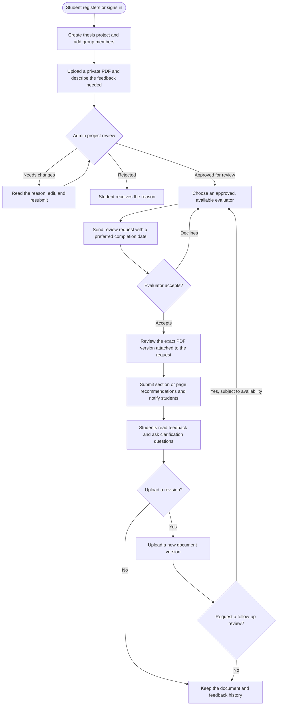
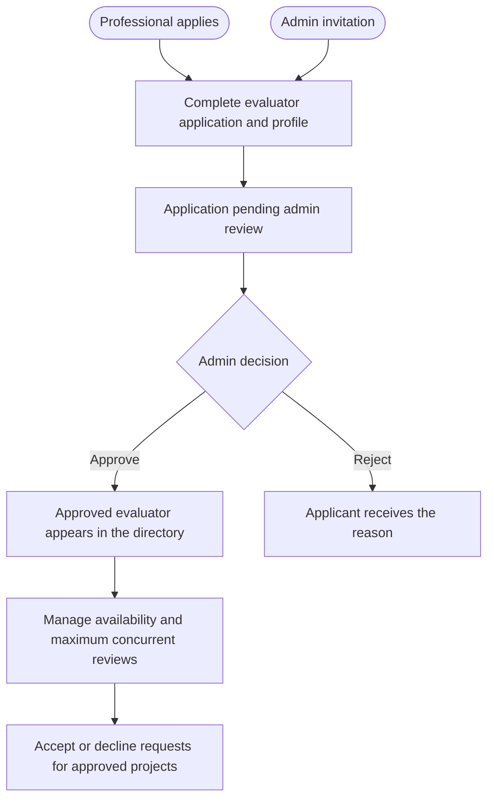
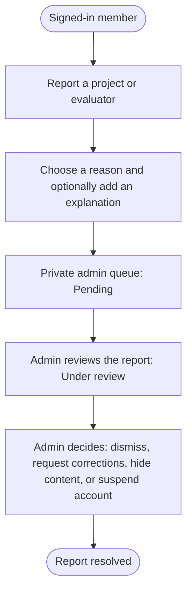
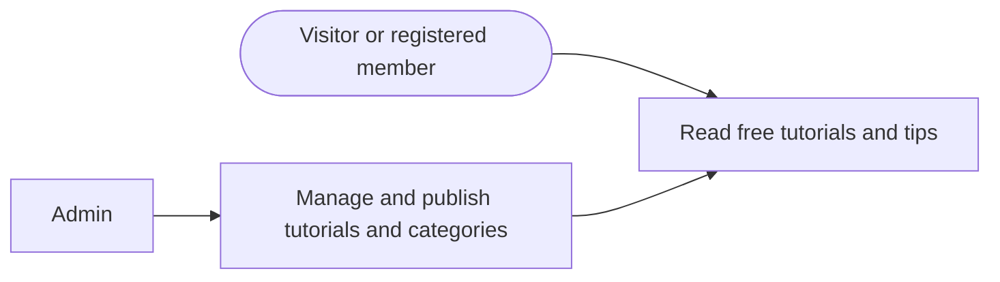

# Analista project flowchart

Planning reference for a free, community-wide thesis feedback and learning platform.

## Thesis submission, review, and revisions

Project approval means eligibility for the platform's review process. Academic approval remains with advisers and panels. Before approval, projects stay private and cannot request evaluator reviews. Public project summaries require student approval. Full thesis files and feedback are restricted to authorized project members, assigned evaluators, and administrators.

## Evaluator application and approval

Profile fields: display name, headline, professional role, years of experience, city, expertise categories, skills, accepting-requests setting, review capacity, online/on-site preference, LinkedIn or portfolio link, and biography. Applications and invitations both require admin approval.

## Reports and moderation

Report reasons include spam, fake information, inappropriate content, harassment, and other. Reporter identities remain private from other users. A report leads to an admin decision after review.

## Tutorials and administration

Tutorials are accessible without submitting a thesis project. Admins also manage accounts, evaluator invitations, project moderation, assignments, stalled requests, and reports. Reviews are voluntary; students propose completion dates and evaluators confirm their availability.

## Visual reference

Use the latest monochrome UI reference: white backgrounds, black and gray accents, thin borders, restrained rounding, left sidebar navigation, and subtle dotted patterns. Use Geist Pixel for prominent headings, Geist for body text and forms, and Geist Mono for compact navigation and labels. Earlier Panelista references guide the functional pages and forms.
